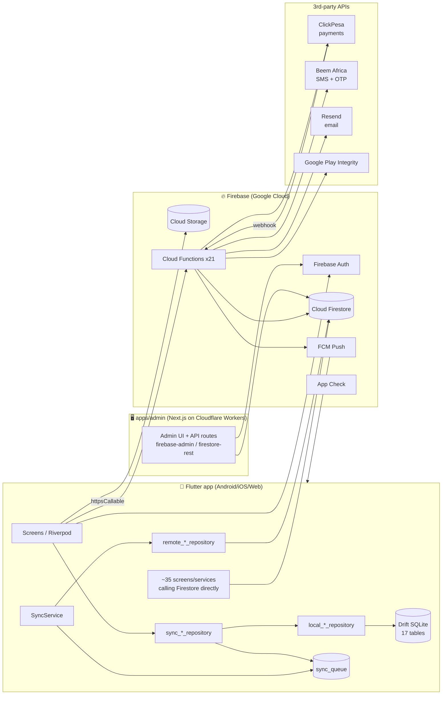
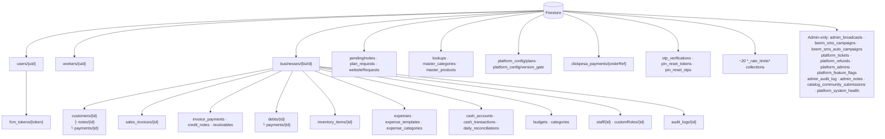
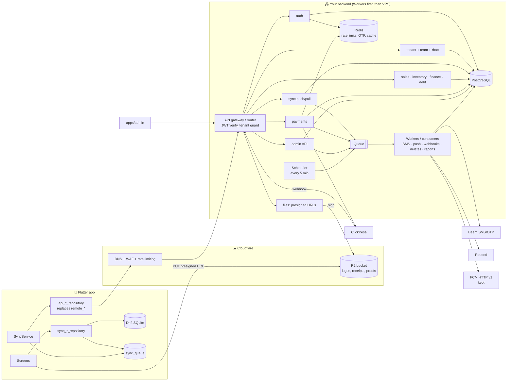
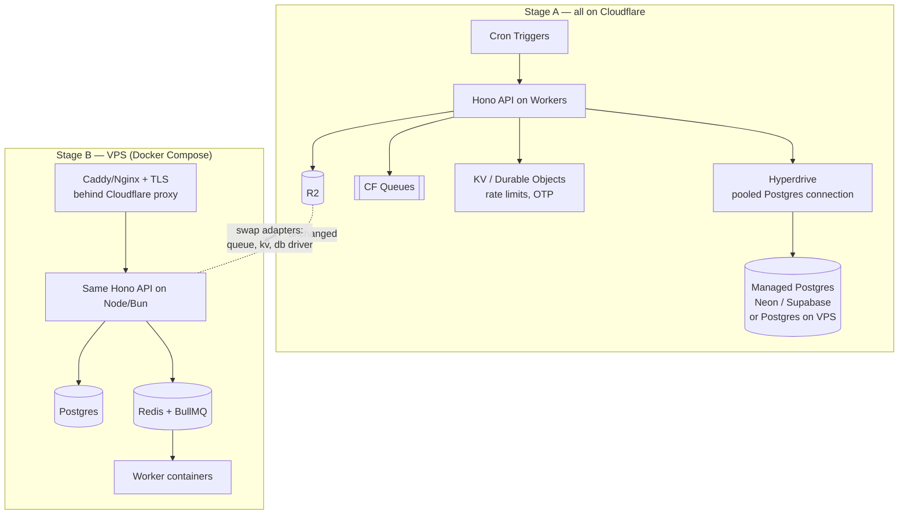
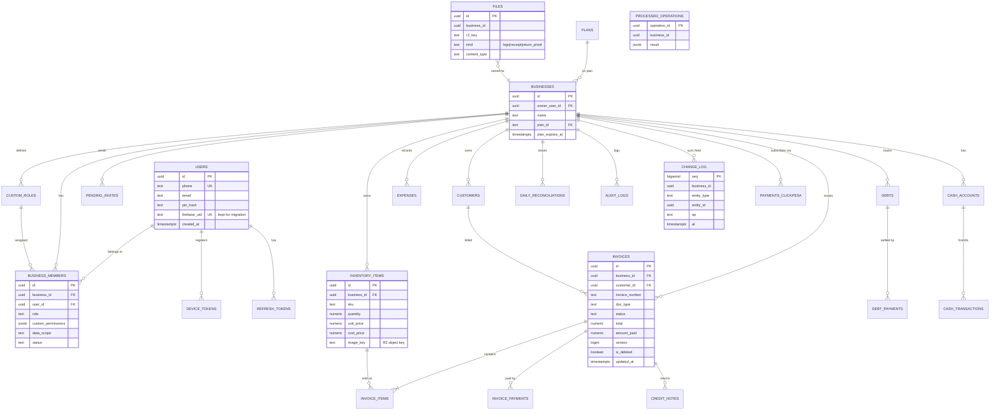
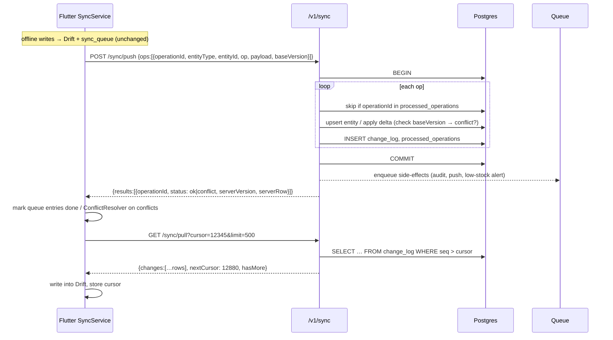
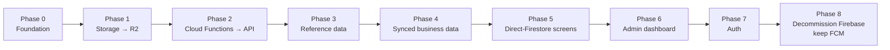
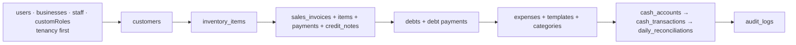
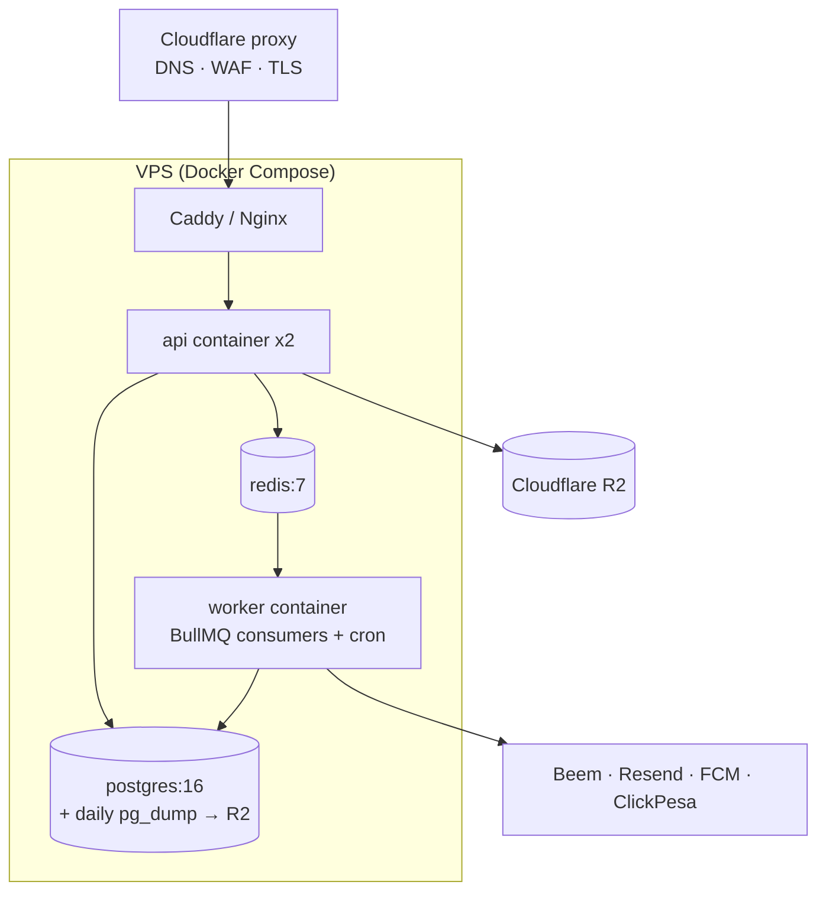

# Mali Up — Firebase → Custom Backend Migration Plan

> Status: proposal · Written 2026-11-03 from a scan of the `dev` branch.
> Open in VS Code Markdown preview (or GitHub) to render the Mermaid diagrams.

---

## 1. What exists today (inventory)

### 1.1 Firebase products in use

| Firebase product | Where | How heavily |
|---|---|---|
| **Firebase Auth** | mobile (49 files), admin dashboard | Phone lookup → PIN-derived password sign-in; password reset for PIN recovery; custom claims for admins |
| **Cloud Firestore** | mobile (54 files), admin (≈28 collections), Cloud Functions | Main cloud database. Firestore's offline cache is **off**; Drift is the local source of truth |
| **Cloud Storage** | mobile (3 upload sites) | Business logos, expense receipts, sales-return proof photos |
| **Cloud Functions (v2)** | `apps/mobile-app/functions/src/*.ts` | 21 functions (see 1.3) |
| **Cloud Messaging (FCM)** | `push_notification_service.dart`, `notifications.ts` | Push notifications; tokens in `users/{uid}/fcm_tokens` |
| **App Check** | `main.dart` | Play Integrity / App Attest tokens attached to callables (enforcement not on yet) |
| Firestore rules / indexes | `firestore.rules` (849 lines), `firestore.indexes.json`, `storage.rules` | **All authorization logic lives here today** |

### 1.2 Current architecture

### 1.3 Cloud Functions inventory

| # | Function | Trigger | Called by | Firestore state it uses | External API | Domain |
|---|---|---|---|---|---|---|
| 1 | `checkDeviceIntegrity` | callable | mobile | `device_integrity_rate_limits` | Play Integrity | Security |
| 2 | `deleteAccountData` | callable | mobile (delete account) | recursive delete over `users`, `workers`, `businesses`, `pendingInvites`, `plan_requests`, `websiteRequests` | — | Account |
| 3 | `initiateClickPesaPayment` | callable | mobile | `businesses`, `platform_config/plans`, `clickpesa_payments`, rate limits | ClickPesa | Payments |
| 4 | `verifyClickPesaPayment` | callable | mobile | `clickpesa_payments`, `businesses` (plan upgrade) | ClickPesa | Payments |
| 5 | `clickpesaWebhook` | HTTP | ClickPesa servers | `clickpesa_payments`, `businesses` | — | Payments |
| 6 | `sendBeemOtp` | callable | mobile | `users`, Beem send rate limits | Beem OTP | OTP |
| 7 | `verifyBeemOtp` | callable | mobile | `otp_verifications`, verify rate limits | Beem OTP | OTP |
| 8 | `consumeOtpVerification` | callable | mobile | `otp_verifications`, `users` | — | OTP |
| 9 | `requestOtpAllowance` | callable | **nothing found** — likely dead code | `otp_rate_limits`, `otp_rate_limits_ip` | — | OTP |
| 10 | `requestPinReset` | callable | mobile | `users`, `pin_reset_tokens`, rate limits | Resend email | PIN recovery |
| 11 | `validatePinResetToken` | callable | mobile / web reset page | `pin_reset_tokens` | — | PIN recovery |
| 12 | `confirmPinReset` | callable | mobile / web reset page | `pin_reset_tokens` + **Auth password update** | — | PIN recovery |
| 13 | `requestPinResetOtp` | callable | mobile | `pin_reset_otps`, rate limits | Beem SMS | PIN recovery |
| 14 | `confirmPinResetOtp` | callable | mobile | `pin_reset_otps` + **Auth password update** | — | PIN recovery |
| 15 | `removeTeamMember` | callable | mobile (team screen) | `businesses/*/staff`, `pendingInvites`, `users`, `workers` | — | Team |
| 16 | `sendAdminBroadcast` | Firestore onCreate `admin_broadcasts/{id}` | admin dashboard | `businesses`, `users/*/fcm_tokens` | FCM | Notifications |
| 17 | `dispatchSmsCampaigns` | cron every 5 min | scheduler | `beem_sms_campaigns`, `beem_sms_auto_campaigns`, `businesses`, `users` | Beem SMS | Marketing |
| 18 | `onUserCreatedWelcomeSms` → `sendWelcomeSms` | Firestore onCreate `users/{uid}` → Cloud Task (+5 min) | Firestore / Cloud Tasks | `users` | Beem SMS | Marketing |
| 19 | `processPendingWelcomeSms` | cron hourly (retry sweep, users created in last 3 days; also retries invite SMS) | scheduler | `users`, `pendingInvites` | Beem SMS | Marketing |
| 20 | `onPendingInviteCreatedSms` | Firestore onCreate `pendingInvites/{id}` | Firestore (owner adds staff / admin quick-setup) | `pendingInvites` | Beem SMS | Team |

Secrets to move into your new secret store: `BEEM_API_KEY`, `BEEM_SECRET_KEY`, `BEEM_OTP_APP_ID`, `BEEM_SMS_SENDER_ID`, `CLICKPESA_CLIENT_ID`, `CLICKPESA_API_KEY`, `CLICKPESA_CHECKSUM_KEY`, `RESEND_API_KEY`, `PIN_RECOVERY_LINK_BASE`, `PIN_RECOVERY_EMAIL_FROM`, plus a Google service account for Play Integrity.

### 1.4 Local database (Drift / SQLite, schema v17) — stays on the device

| Table | Synced? | Sync `entityType` | Notes |
|---|---|---|---|
| `invoices` | ✅ | `invoice` | docType, status, totals, returns/credit notes |
| `invoice_items` | ✅ (with invoice) | — | line items |
| `customers` | ✅ | `customer` | `balance` updated via **delta** |
| `expenses` | ✅ | `expense` | |
| `inventory` | ✅ | `inventory_item` | `quantityDelta` → server must apply atomically |
| `debts` | ✅ | `debt` | interest fields, write-offs |
| `debt_payments` | ✅ | `debt_payment` | |
| `team_members` | ✅ | `team_member` | role, customPermissions, dataScope |
| `cash_accounts` | ✅ | `cash_account` | |
| `cash_transactions` | ✅ | `cash_transaction` | |
| `daily_reconciliations` | ✅ | `reconciliation` | |
| `master_categories`, `master_products` | ⬇ pull only | — | global catalog (admin-managed) |
| `sync_queue` | local only | — | operationId, payload, checksum, retries |
| `user_settings`, `business_settings` | local only | — | |
| `notification_log` | local only | — | |

Every synced row already carries `id (UUID)`, `businessId`, `createdAt`, `updatedAt`, `serverUpdatedAt`, `syncStatus`, `localVersion`, `isDeleted`. **This is the single biggest asset for the migration**: the app already speaks an "offline queue + incremental pull since timestamp" protocol, so the new backend only has to implement that protocol — the UI layer does not change.

### 1.5 Firestore data model (cloud)

Cloud Storage paths: `businesses/{uid}/…` (logos), `users/{uid}/…`, `documents/{uid}/…`, `receipts/{uid}/…`, `returns/{uid}/…`.

### 1.6 What `services/` contains today
`auth-service` (Fastify + Prisma, `User` + `Session` models) and `audit-service` (4 files) have code; the other 12 folders are empty. Nothing calls them. Treat them as a starting skeleton, not something to preserve.

---

## 2. Target architecture

### 2.1 Recommendation: modular monolith + async workers, not 14 microservices (yet)

You asked for "microservices". For one team shipping one app, 14 separately deployed services mean 14 deploy pipelines, network hops on every invoice, and distributed transactions (an invoice touches customers, inventory, debts and cash at the same time — today that's one Drift transaction). The safer path:

- **One API codebase** split into modules that map 1:1 to future services (`auth`, `tenant`, `sync`, `sales`, `inventory`, `finance`, `debt`, `team`, `payments`, `notifications`, `files`, `admin`).
- **One Postgres database** with one schema per module, so a module can later be pulled out with its own DB.
- **Async work through a queue** (SMS, push, webhooks, PDF/report jobs, cascaded deletes) handled by separate worker processes. This is the "async" part, and it's where the real scalability comes from.
- Split a module into its own service only when it has a different scaling or release need. `notifications` and `payments` are the likeliest first candidates.

### 2.2 Target diagram

**Firebase is not removed completely.** Keep **FCM**: on Android it is the push transport, and it's free. Your backend sends through the FCM HTTP v1 API with a service account. App Check can be swapped for calling Play Integrity directly from your backend (you already do this in `checkDeviceIntegrity`).

### 2.3 Tech choices

| Concern | Choice | Why |
|---|---|---|
| Language/runtime | TypeScript | Your Cloud Functions and `services/` are already TS |
| HTTP framework | **Hono** | Runs unchanged on Cloudflare Workers **and** Node/Bun on a VPS, which is what makes "Workers first, VPS later" cheap. (Fastify, used in `auth-service`, does not run on Workers.) |
| Database | **PostgreSQL 16** | Relational money data, transactions, `SELECT … FOR UPDATE` for stock and balance deltas |
| ORM / SQL | Drizzle ORM (or Prisma with the `pg` driver adapter) | Both work on Workers and Node; Drizzle is lighter on Workers |
| Cache / rate limit / OTP | Redis (VPS) or Workers KV / Durable Objects (Workers) | Replaces the ~20 `*_rate_limits` collections and the OTP/PIN-token collections |
| Queue | Cloudflare Queues (Workers) → BullMQ on Redis (VPS) | Hide it behind one `enqueue(job)` interface so the swap is a single file |
| Scheduler | Workers Cron Triggers → `node-cron`/BullMQ repeatable jobs | Replaces the two `onSchedule` functions |
| File storage | **Cloudflare R2** (S3-compatible API) | Zero egress fees; presigned PUT/GET |
| Auth tokens | Own JWT (access 15 min + rotating refresh token), `jose` library | `jose` works on both runtimes |
| PIN hashing | Argon2id (VPS) / scrypt via WebCrypto-compatible lib (Workers) | |

---

## 3. Can the backend run on Cloudflare Workers before the VPS? — Yes

It's directly related, and a sensible stepping stone. Your admin dashboard **already runs on Workers** (`apps/admin/wrangler.toml`, OpenNext), and `apps/admin/lib/firestore-rest.ts` exists because `firebase-admin`'s gRPC client doesn't run there. You've already met the main Workers constraint.

**Running on Workers works well when:**
- requests are short (CRUD, sync push/pull, presigning, webhook intake);
- you put Postgres behind **Hyperdrive** (Workers can't keep a normal connection pool);
- R2 is a native binding, so there are no credentials in code.

**Watch out for:**
- CPU-time limits per request. Heavy PDF or report generation and big recursive deletes should go to a Queue consumer.
- No raw TCP pooling without Hyperdrive, and no `firebase-admin` (use REST, as the admin app already does).
- Node APIs need the `nodejs_compat` flag; avoid native Node modules (e.g. the `argon2` npm package).
- Cost moves from per-request pricing to a fixed VPS price as traffic grows, which is usually the reason to move later.

**To keep the code portable**, put every runtime-specific thing behind a small interface: `Db`, `Queue`, `KeyValue/RateLimiter`, `ObjectStorage`, `Secrets`. Workers and VPS each get their own adapter file; route and business code never import `cloudflare:*` or `bullmq` directly.

A valid alternative is to skip Workers and go straight to the VPS. Workers mainly buy you time: no server ops while you build the backend, and a free/cheap tier while traffic is small.

---

## 4. Target PostgreSQL schema (core)

Multi-tenant by `business_id` on every business table. Optionally enforce it with Postgres Row-Level Security, which replaces what `firestore.rules` does today.

Design rules:
- **Same UUIDs as the app.** The app generates IDs offline; Postgres uses them as primary keys, which keeps the backfill and sync simple.
- **Money as `numeric(14,2)`**, never float.
- **`processed_operations`**: the app's `sync_queue.operationId` becomes an idempotency key, so a retried push never double-applies a sale.
- **`change_log` with a `bigserial` cursor** replaces `fetchUpdatedSince(timestamp)`. Clocks can lie; sequence numbers can't.
- Deltas (`customers.balance`, `inventory.quantity`) are applied in SQL (`UPDATE … SET quantity = quantity + $delta`), so concurrent devices don't overwrite each other.
- Rate limits, OTPs and PIN-reset tokens go to **Redis/KV with TTL**, not Postgres tables.
- Admin-only collections (`platform_*`, `beem_sms_*`, `admin_*`) get their own `admin` schema.

---

## 5. New sync protocol (replaces direct Firestore in `remote_*_repository`)

**Client-side impact:** each `remote_<entity>_repository.dart` already exposes a small interface (`saveAndGetTimestamp`, `applyBalanceDeltaAndGetTimestamp`, `delete`, `fetchById`, `fetchUpdatedSince`). Write `api_<entity>_repository.dart` with the same methods, and pick the implementation per entity behind a feature flag (e.g. from `platform_config` / version gate). The `sync_*` repositories, Drift and the UI stay as they are.

---

## 6. Step-by-step migration order

The guiding principle is the strangler pattern: move one slice at a time, keep Firebase running alongside, and never do a big-bang cutover. Move the least-coupled pieces first and auth last.

### Phase 0 — Foundation (nothing user-facing changes)
1. Create `services/api` (Hono + TS) with the module folders from §2.1. Retire the empty service folders, or keep them as module names.
2. Provision Postgres (managed or on the VPS) and write migrations for the §4 schema.
3. **Auth bridge:** the API accepts **Firebase ID tokens** at first. Verify them with `jose` against Google's public JWKS (`securetoken@system.gserviceaccount.com`) and map `firebase_uid → users.id`. You can then move everything else without touching login.
4. Port the authorization rules from `firestore.rules` (membership, role, `dataScope`, `customPermissions`) into one `requireBusinessAccess(permission)` middleware. Write tests for it first, because this is the security-critical step.
5. Set up adapters (`Db`, `Queue`, `KV`, `Storage`), CI, staging environment, structured logs, and a `/health` endpoint.
6. Build a **Firestore → Postgres backfill script** (Admin SDK/REST, idempotent upserts by ID, re-runnable). You'll run it again and again.

### Phase 1 — Storage → Cloudflare R2 (easiest, fully independent)
Only 3 upload sites: [manage_businesses_screen.dart](../apps/mobile-app/lib/features/business/presentation/screens/manage_businesses_screen.dart), [add_expense_screen.dart](../apps/mobile-app/lib/features/finance/presentation/screens/add_expense_screen.dart), [sales_return_screen.dart](../apps/mobile-app/lib/features/sales/presentation/screens/sales_return_screen.dart).
1. Create R2 bucket `maliup-files` (private) plus an optional public custom domain for logos.
2. API: `POST /v1/files/upload-url {kind, contentType, size}` → validates membership, size and type, then returns a presigned PUT URL and `key` (`biz/{businessId}/{kind}/{uuid}.jpg`). `GET /v1/files/{id}/url` → short-lived presigned GET.
3. App: replace `FirebaseStorage.putFile` with `http.put(presignedUrl, bytes)` behind a `FileUploadService`. **Store the key, not the URL**, in the entity.
4. Copy existing objects with `rclone` (GCS → R2) and rewrite stored URLs to keys with a script.
5. Keep reading old Firebase URLs until the backfill is done, then lock `storage.rules` to read-only.

### Phase 2 — Cloud Functions → API endpoints + queue jobs
They're already server-side and called through a few `httpsCallable` sites, so each one is a contained swap. Suggested order (lowest risk first):

| Order | Function(s) | New home | Notes |
|---|---|---|---|
| 2.1 | `requestOtpAllowance` | — | Confirm unused, then **delete** instead of porting |
| 2.2 | welcome + invite SMS (triggers + task + hourly sweep), `dispatchSmsCampaigns` | Cron → queue → `notifications` worker | Read from Firestore at first, from Postgres after Phase 4/6 |
| 2.3 | `sendAdminBroadcast` | `POST /admin/broadcasts` → queue → FCM worker | Replaces the Firestore trigger with an explicit API call |
| 2.4 | `checkDeviceIntegrity` | `POST /v1/security/integrity` | Stateless apart from the rate limit → Redis/KV |
| 2.5 | `sendBeemOtp`, `verifyBeemOtp`, `consumeOtpVerification` | `auth` module | OTP state → Redis with TTL |
| 2.6 | `initiateClickPesaPayment`, `verifyClickPesaPayment`, `clickpesaWebhook` | `payments` module | **Change the webhook URL in the ClickPesa dashboard.** Run both endpoints in parallel for a while; the webhook must be idempotent on `orderReference` |
| 2.7 | `removeTeamMember`, `deleteAccountData` | `team` / `account` modules; heavy deletes → queue job | Must delete from **both** Firestore and Postgres during the transition |
| 2.8 | `requestPinReset*`, `validatePinResetToken`, `confirmPinReset*` | `auth` module | Still calls Firebase Auth (`updateUser` via REST) to set the password until Phase 7 |

App change per function: swap `FirebaseFunctions.instance.httpsCallable('x')` for `apiClient.post('/v1/...')`. Make `apiClient` attach the Firebase ID token for now.

### Phase 3 — Reference / read-mostly data
`lookups`, `master_categories`, `master_products`, `platform_config/plans`, `platform_config/version_gate`.
- These are read-only for the app and written by admin, so the risk is low. Backfill once, serve through `GET /v1/catalog/...` with ETag/Cloudflare caching, and switch `master_catalog_repository.dart`, `lookup_service.dart`, `plan_service.dart` and `version_gate_service.dart`.
- **Do `version_gate` early.** It's your lever to force users onto an app build that talks to the new API (see Phase 4).

### Phase 4 — Synced business data (the main event)
Move in dependency order, one entity at a time:

For **each** entity:
1. Implement `POST /sync/push` and `GET /sync/pull` handling for that `entityType` (§5).
2. Add `api_<entity>_repository.dart` and a per-entity flag in `SyncService` that picks API vs Firestore.
3. **Bridge period.** Older app versions still write to Firestore, so you have two options:
   - **(Recommended) Forced upgrade:** ship the build, raise `version_gate` minimum once ~95% have updated, backfill Firestore → Postgres, flip the flag, then re-run the backfill to catch late writes.
   - **(Smoother but more work) Bridge:** a small job copies Firestore changes into Postgres every few minutes until no old clients remain.
4. Verify with per-business counts and sums (invoice totals, customer balances, stock quantities) between Firestore and Postgres before flipping.
5. Once flipped, make that Firestore collection read-only in `firestore.rules`.

Moving `invoice`, `customer`, `inventory`, `debt` and `cash_transaction` together in one release is acceptable if you want fewer forced upgrades. They touch each other on every sale.

### Phase 5 — Screens that call Firestore directly
About 35 files bypass the sync layer: team invites (`pendingInvites`), `staff`, `customRoles` (rbac), `audit_logs`, `plan_requests`, settings, customer notes and payments, parts of sales, dashboard and reports. Most are in `features/sales`, `features/customer`, `features/finance`, `features/team`, `core/services`. For each one, decide:
- **should it be offline?** → route it through the sync layer (new entityType), or
- **online-only?** (invites, plan requests, team admin) → plain REST endpoint.

Find them with `grep -rl "package:cloud_firestore/" apps/mobile-app/lib`. Once the list is empty, remove `cloud_firestore` from `pubspec.yaml`.

### Phase 6 — Admin dashboard (`apps/admin`)
Replace `lib/firebase-admin.ts` and `lib/firestore-rest.ts` calls with calls to the `/admin/*` API. Migrate the admin-only collections (`platform_*`, `beem_sms_*`, `admin_*`, `catalog_community_submissions`) to the `admin` schema. Admin login moves to the new auth in Phase 7. Until then, keep verifying the Firebase custom claim.

### Phase 7 — Auth (last, most sensitive)
1. Export users: `firebase auth:export users.json --format=json`. It includes scrypt password hashes; get the hash parameters from Console → Authentication → ⋮ → Password hash parameters.
2. Import into `users` (`firebase_uid`, phone, email, `legacy_scrypt_hash`).
3. `POST /v1/auth/login {phone, pin}`: if `pin_hash` is null, verify against the Firebase scrypt hash (`firebase-scrypt` algorithm), then re-hash with Argon2id/scrypt and store it. Users notice nothing and never need a reset.
4. Issue your own JWT access + refresh tokens. The gateway accepts **both** Firebase and own tokens during rollout.
5. PIN recovery (Phase 2.8 endpoints) now writes `pin_hash` directly.
6. When nearly all active users have logged in on the new build, stop accepting Firebase ID tokens.

### Phase 8 — Decommission
Remove `firebase_auth`, `cloud_firestore`, `firebase_storage` and `cloud_functions` from the app. Keep `firebase_core` + `firebase_messaging` (FCM). Take a final Firestore export to cold storage, then delete the functions, set Firestore rules to deny-all, and later delete the data. Remember the web build: it was online-only against Firestore, so it now pulls from `/sync/pull`.

---

## 7. VPS deployment (Stage B)

Minimum operational checklist: automated Postgres backups to R2 with a tested restore, point-in-time recovery (WAL archiving via `pgBackRest` or `wal-g`), monitoring/alerts (Uptime Kuma, Grafana/Prometheus or a hosted APM), secrets in env files outside git, a firewall that only exposes 80/443 (Cloudflare IPs only), unattended security upgrades. The existing `docker-compose.yml` (Postgres, Mongo, Redis) is a starting point; drop MongoDB unless you have a concrete use for it.

---

## 8. Risks & decisions to make

| Risk | Mitigation |
|---|---|
| Losing the authorization rules encoded in `firestore.rules` | Port them into a single tested middleware **before** exposing any data endpoint |
| Old app versions writing to Firestore after the cutover | `version_gate` forced upgrade + repeatable backfill |
| Double-applied sales on retry | `operationId` idempotency table |
| Stock/balance races between devices | SQL delta updates within transactions |
| Password migration | Lazy re-hash from the Firebase scrypt export, so no forced PIN reset |
| Payment webhooks lost during the switch | Both webhook endpoints live in parallel; idempotent by `orderReference` |
| Running a database yourself on a VPS | Managed Postgres (Neon/Supabase) is an option even when the API runs on the VPS |

Decisions for you: (1) Workers stage first or straight to the VPS? (2) Managed or self-hosted Postgres? (3) Forced upgrade or bridge for Phase 4? (4) Which Phase 5 screens must work offline?
